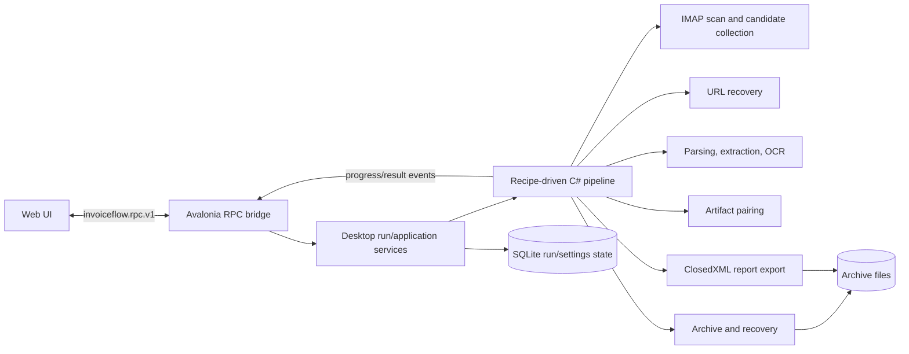

# Desktop Python-to-C# Replacement Design

**Status:** Conversation design approved; written-spec review pending  
**Date:** 2026-09-25

## Goal

Replace Python as the InvoiceFlowAI desktop application's runtime and business-processing engine with C#. Avalonia is the formal desktop entrypoint, and the existing typed `invoiceflow.rpc.v1` bridge remains the frontend boundary. The finished desktop application must start and complete its supported workflow without Python installed or launched.

This is a staged migration, not a Python sidecar design. Python may remain temporarily as the old application and as a behavior reference while individual C# stages are brought to parity. It must not be a runtime dependency of the C# application, and it is removed from the desktop release path at cutover.

## Approved Scope

- Migrate the desktop application's remaining Python-owned behavior to C#.
- Retire the old pywebview desktop entrypoint and its Python desktop packaging/build path after C# acceptance.
- Remove `plugins/dsh-invoice-downloader` directly; do not port that plugin to C#.
- Stop shipping the macOS desktop release. The supported desktop release target after migration is Windows x64.
- Keep the current C# report workbook structure: `Summary`, `Invoices`, and `Manual Reviews`. Matching the legacy Python worksheet names and layout is not required.
- Do not commit the design or implementation changes unless separately requested.

Python-only development utilities that are neither desktop runtime dependencies nor part of the removed DSH plugin are outside this migration unless discovery shows they are required to build, package, or run the desktop application. Python tests that exclusively exercise retired desktop implementation are temporary migration references and should be retired or replaced with C# coverage at cutover.

## Architecture

The Avalonia host owns the desktop lifecycle and native window/file actions. The frontend communicates with C# through typed RPC. A C# application service admits and controls a run, creates the existing recipe-driven pipeline, and publishes sequenced run events. Pipeline stages use Application contracts and Infrastructure implementations; persistence, archive files, and report files remain behind their existing C# abstractions.

There is no Python process, stdin/stdout protocol, or Python-owned business facade in this target architecture. Existing credentials and secrets continue to follow the current typed settings/security boundary; secret values are not returned in ordinary DTOs or included in logs/events.

## Existing C# Foundation and Integration Gap

The following are concrete implementations, not package-reference assumptions:

- `MailKitMailboxScanner` and `MailKitMailboxSession` implement mailbox scanning and attachment/URL discovery.
- `CandidateCollectionStage` handles candidate ordering, filtering, identity, and history duplicate checks.
- `UrlRecoveryStage` and the registered recovery strategies implement recovery; the URL worker protocol validates and imports selected artifacts.
- `DocumentExtractionStage`, format parsers, field extraction, PDF rendering, and `SimdPaddleOcrFallback` implement document processing.
- `ArtifactPairingStage` performs ride/hotel artifact pairing.
- `DocumentArchivingStage` and `ArchiveRecoveryService` implement archive commit and recovery.
- `RunCoordinator`, terminal-decision services, event replay, and related stores implement durable packet/final-state primitives.
- `ClosedXmlReportExporter` implements the accepted C# workbook structure.

The primary integration gap is that these capabilities are not yet wired as a complete desktop run lifecycle through the Avalonia host and RPC surface. `AppRpcComposition` currently registers settings/account/secret/provider/directory methods but not the full run, result, and file-operation surface. The migration must also verify Python/C# behavior parity for business rules and provider cases; the presence of a C# implementation alone is not proof of parity.

## Legacy Surface Mapping

| Legacy frontend operation | C# target |
| --- | --- |
| `get_run_context` | Typed run-context/bootstrap RPC backed by the desktop application service |
| `start_processing` | Typed run-start RPC; C# owns admission, validation, and pipeline execution |
| `get_progress` | Sequenced `run.progress` events plus a typed progress snapshot RPC where reconnect/refresh needs it |
| `stop_processing` | Typed cancellation RPC connected to the active run's cancellation token and durable cancellation state |
| `get_results` | Typed result-query RPC backed by persisted run/candidate/archive state |
| `open_folder`, `open_manual_check_folder`, `view_invoice` | C#-owned, path-validated native file/folder actions |
| `export_run_summary` | C# `ClosedXmlReportExporter`; retain the currently implemented C# sheet structure |
| `minimize_window`, `maximize_window`, `close_window` | Avalonia native window commands, without a Python facade |
| `load_user_settings` legacy fallback | Remove after typed settings bootstrap is authoritative |

No remaining desktop action may call `window.pywebview.api` after cutover. Native window and file actions may use host commands rather than business RPC if that matches the existing Avalonia bridge conventions.

## Vertical Migration Stages

### 1. Run Control and Typed Desktop Surface

Wire C# run admission and the existing lifecycle primitives into the Avalonia composition root. Add the typed start, progress, stop/cancel, result, and run-context contracts and frontend routing. Implement native window/file operations on the C# host. Establish deterministic tests for rejection, cancellation, event ordering, reconnect snapshots, safe errors, and terminal results.

### 2. End-to-End C# Processing Pipeline

Connect the existing scanner, candidate collection, URL recovery, extraction, and pairing stages to the admitted run. Build a provider/rule parity matrix from existing behavior and synthetic fixtures. For each supported case, assert candidate identity/order, extracted fields, status/reason codes, and safe handling of credentials and signed URLs. Add or complete C# tests where parity is not already covered.

### 3. Archive, Results, and Report Export

Connect archive/recovery and result projection to final run state. Verify source files are not mutated, partial commits are surfaced for recovery/manual review, and report export is performed in C# with `Summary`, `Invoices`, and `Manual Reviews`. Test the exported workbook contents and deterministic content identity using the current C# report contract.

### 4. Runtime and Release Retirement

Only after the C# path passes acceptance, remove the old pywebview entrypoint, desktop-only Python runtime/business modules, and Python desktop packaging path. Remove the DSH plugin directory as approved. Make the Windows x64 C# release the only desktop release, removing macOS desktop packaging/release references and updating product documentation to match. Retain unrelated development tools only when they are not required by the product runtime/release and do not reintroduce the retired desktop engine.

Stages are independently reviewable and testable. The old desktop can remain available as a temporary fallback during migration, but it is not launched by, embedded in, or required by the C# application.

## Acceptance Criteria

- Every supported desktop workflow has a C# implementation and typed host/UI path; there are no desktop calls through `window.pywebview.api`.
- The C# host runs the complete mailbox-to-result/archive/report workflow, including empty mailboxes, duplicates, recoverable failures, manual review, cancellation, and finalization.
- Run state, progress events, results, and failure messages are stable, sequenced, and safe to expose; secrets and sensitive URL tokens are not leaked.
- Existing C# and newly added focused .NET tests cover each migrated stage; Avalonia NativeWebView RPC acceptance covers the real bridge path.
- Export produces a valid workbook with the accepted C# sheets and expected rows/counts.
- A clean Windows x64 release build and startup/workflow smoke test pass with Python unavailable (including Python removed from `PATH`). The release artifact contains no Python interpreter, venv, PyInstaller bundle, or Python desktop engine.
- No macOS desktop release is produced or advertised after retirement; the DSH plugin is absent from the repository after its approved removal stage.
- Existing C# settings/account/secret behavior remains intact through the migration.

## Risks and Controls

- **Behavior drift:** Use synthetic fixtures and explicit parity assertions before deleting the Python reference implementation.
- **Premature retirement:** Keep the release cutover last; require the C# end-to-end acceptance criteria first.
- **Partial archive writes:** Preserve the existing transactional archive/recovery model and test interrupted/partial pair commits.
- **RPC/frontend drift:** Keep DTOs strict and camelCase; test request/response/event round trips and the NativeWebView transport.
- **Release residue:** Add a release-artifact audit so obsolete Python runtime files and macOS desktop assets cannot silently return.

## Design Decisions

- Use the existing C# pipeline and typed RPC as the target architecture; do not create a Python sidecar.
- Migrate in independently verifiable vertical stages.
- Replace Python in the desktop runtime and remove the DSH plugin; do not expand scope to unrelated development utilities without evidence they are product dependencies.
- C# Excel export is authoritative, and the existing C# workbook structure is accepted.
- Windows x64 is the only desktop release target after migration.
